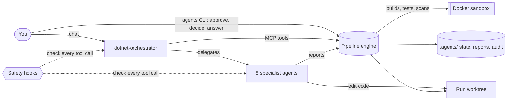
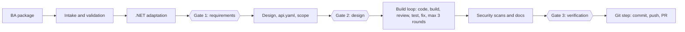
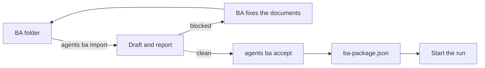

<div align="center">

# TechWave .NET Agents

**From business requirements to a reviewed, tested .NET pull request, with AI doing the work and you making every decision.**


[Quick start](#quick-start) · [How it works](#how-it-works) · [User guide](#user-guide) · [Command reference](#command-reference) · [Troubleshooting](#troubleshooting)

</div>

---

<a id="why"></a>

## ✨ Why dotnet-agents

Most AI coding tools write code and hope you catch the mistakes. `dotnet-agents` is built the other way round.

| 🤖 The AI does the work | ⚙️ The engine checks it | 🧑‍💻 You decide |
|---|---|---|
| An orchestrator and eight specialist agents adapt the requirements, design the module, write code and tests, review, fix, scan and document. | A deterministic engine owns the order of work, the limits and every check. A specialist's "done" counts only when the engine accepts its report. | Three approval gates, every technology choice and every Git action are yours, from your own terminal. The AI cannot approve its own work. |

**What you get from one run:** an adapted .NET design, a module design with its API contract, code inside an approved scope, a test for every acceptance criterion, review findings, security scans, documentation, and a pull request.

---

<a id="demo"></a>

## 🎬 What a run looks like

```text
You:    Start a run for the Orders module with ba/orders/ba-package.json, greenfield.

Agent:  Project: C:\src\orders-service
        Run R-0001 started. The adapter is mapping the requirements to .NET.
        One decision waits for you: DEC-001, data access. The card shows two
        options with pros, cons and my recommendation.
        Run: agents decide R-0001 DEC-001 <option-id>

You:    (in your terminal) agents decide R-0001 DEC-001 <option-id>
You:    continue

Agent:  Gate 1 is ready: the adapted design and the BA review lists.
        Review it, then run: agents approve R-0001 gate-1
```

The orchestrator always tells you what it needs and the exact command. A "yes" in the chat never approves anything.

---

<a id="quick-start"></a>

## 🚀 Quick start

> [!NOTE]
> You need the **.NET 10 SDK**, **Git**, **Docker** (recommended) and **Claude Code** or **GitHub Copilot** on a business plan. Full list: [Requirements](#1-requirements).

**1. Install the plugin** (pick your host)

```bash
# Claude Code
claude plugin marketplace add karthikeya-reddy-bommireddy/DotNet-Plugin-Warehouse-Techwave
claude plugin install dotnet-agents@techwave-dotnet

# GitHub Copilot CLI (VS Code picks this up too)
copilot plugin marketplace add karthikeya-reddy-bommireddy/DotNet-Plugin-Warehouse-Techwave
copilot plugin install dotnet-agents@techwave-dotnet
```

**2. Install your `agents` command** (once per machine)

```bash
git clone https://github.com/karthikeya-reddy-bommireddy/DotNet-Plugin-Warehouse-Techwave.git
dotnet tool install --global Agents.Cli --add-source DotNet-Plugin-Warehouse-Techwave/cli
agents verify
```

**3. Prepare your project** (a Git repository's top folder with at least one commit)

```bash
cd my-service
agents init
```

**4. Bring the requirements**: put the BA package (`ba.json`) in the project, or import a BA document folder:

```bash
agents ba import ba/orders
agents ba accept IMP-0001
```

**5. Start the run**: restart your AI host, open the **dotnet-orchestrator** agent and say:

> Start a run for the Orders module with ba/orders/ba-package.json, greenfield.

> [!IMPORTANT]
> Keep your AI host in a mode that **asks before it acts**: no auto-approve, no Autopilot, no `--yolo`. See [Host settings](#host-settings).

---

<a id="how-it-works"></a>

## 🧭 How it works



- **You** talk to the orchestrator in the chat, and use the `agents` command in your own terminal for every approval and decision.
- **The orchestrator** asks the engine for the next step, delegates to specialists and explains the results. It never edits code and never approves anything.
- **The engine** (an MCP server inside the plugin) keeps the run's state, validates every report, runs builds, tests and scanners, and refuses anything out of order.
- **The hooks** check every tool call: no writes outside the approved scope, no secrets, no unsafe Git commands, no self-approval.
- **The run worktree** is a separate Git worktree next to your project. All changes happen there until you commit.

### The flow of a run



### The agents

| Agent | When it works | What it produces |
|---|---|---|
| `dotnet-orchestrator` | Always; the one you talk to | Status, decisions to make, gate packages, the Git proposal |
| `dotnet-adapter` | Adaptation, in checked batches | The .NET view of the requirements: architecture, solution structure, data model, API, standards, dependencies, security, testing strategy, technology options |
| `dotnet-designer` | Design | A module design (new module), a change design (existing code) or a design note (small change), with `api.yaml` and the scope |
| `dotnet-coder` | Build loop, round 1 | Code inside the approved scope |
| `dotnet-reviewer` | Build loop | Review findings with evidence |
| `dotnet-tester` | Build loop | A test for every acceptance criterion |
| `dotnet-fixer` | Build loop, rounds 2 and 3 | Fixes for the failures of the last round only |
| `dotnet-security` | Security and documentation | An interpretation of the secret, dependency, licence and analyzer scans |
| `dotnet-docs` | Security and documentation | XML documentation of public APIs, a module README, change notes |

---

<a id="user-guide"></a>

## 📘 User guide

<details open>
<summary><b>Contents</b></summary>

1. [Requirements](#1-requirements)
2. [Installation](#2-installation)
3. [Preparing a project](#3-preparing-a-project)
4. [Preparing the BA input](#4-preparing-the-ba-input)
5. [Running a feature](#5-running-a-feature)
6. [Gates and decisions](#6-gates-and-decisions)
7. [The Git step](#7-the-git-step)
8. [Pausing, resuming, rolling back and re-running](#8-pausing-resuming-rolling-back-and-re-running)
9. [Configuration](#9-configuration)
10. [Safety model](#10-safety-model)
11. [Files and folders](#11-files-and-folders)
12. [Updating, pinning a version, uninstalling](#12-updating-pinning-a-version-uninstalling)

</details>

### 1. Requirements

| What | Details |
|---|---|
| **.NET SDK 10** | The engine runs on .NET 10 (`dotnet --version` shows 10.x). Your projects use the SDK their own files ask for. |
| **Git** | Any recent version. Your project must be a Git repository with at least one commit. |
| **An AI host** | Claude Code, GitHub Copilot CLI, or VS Code with the GitHub Copilot Chat extension. Visual Studio works through project files; see [Known limitations](#known-limitations). |
| **A business plan** | Claude Team, or GitHub Copilot Business. The agents use cloud Claude models only. |
| **Models** | In GitHub Copilot, Claude Opus 5.5 or Claude Sonnet 5.5 must be enabled for you. In Claude Code the agents use your session's model. |
| **Docker** (recommended) | Builds and tests run in a container with no network access and no extra privileges, using `mcr.microsoft.com/dotnet/sdk:10.0` by default. Only two steps reach the network: package restore and the vulnerable-package check. Without Docker the build step stops with "Docker is not available here"; you can start Docker, or set `sandbox.mode` to `process` (see [Configuration](#9-configuration)). |
| **GitHub CLI** (optional) | `gh`, signed in (`gh auth status`). Needed only to open pull requests from the Git step. |
| **gitleaks** (optional) | A second secret scanner, used when installed. The built-in scanner always runs. |
| **Platforms** | Windows and Linux. |

> [!TIP]
> **Windows:** run `git config --global core.longpaths true` once. Without it, cloning this repository or creating run worktrees can fail with "Filename too long".

### 2. Installation

Install the plugin in each AI host you use, then install the `agents` command once per machine.

#### 2.1 Claude Code

```bash
claude plugin marketplace add karthikeya-reddy-bommireddy/DotNet-Plugin-Warehouse-Techwave
claude plugin install dotnet-agents@techwave-dotnet
claude plugin list
```

Restart Claude Code. Optional, recommended: `agents init --permissions` adds the plugin's Git rules to your Claude Code settings (a plugin cannot ship them); see [Preparing a project](#3-preparing-a-project).

#### 2.2 GitHub Copilot CLI

```bash
copilot plugin marketplace add karthikeya-reddy-bommireddy/DotNet-Plugin-Warehouse-Techwave
copilot plugin install dotnet-agents@techwave-dotnet
copilot plugin list
```

VS Code also finds the plugins Copilot CLI installed.

#### 2.3 VS Code

Either install with Copilot CLI (above, recommended, because updates are then one command), or in VS Code open the Command Palette (`Ctrl+Shift+P`), run **Chat: Install Plugin From Source**, and enter `https://github.com/karthikeya-reddy-bommireddy/DotNet-Plugin-Warehouse-Techwave`. Restart VS Code.

#### 2.4 Visual Studio, or when plugins are blocked: project files

The `project-files/` folder holds the same agents as files to copy into a project:

| Host | Copy into the project's root folder |
|---|---|
| GitHub Copilot (Visual Studio, VS Code) | The `.github/` and `.vscode/` folders from `project-files/copilot/` |
| Claude Code | The `.claude/` folder and `.mcp.json` from `project-files/claude-code/` |

If the project already has `.vscode/settings.json` or `.claude/settings.json`, merge the settings instead of replacing the file. Project files run the `agents` command from your PATH, so install it (below) first.

#### 2.5 The `agents` command (once per machine)

You approve gates and record decisions with `agents` in your own terminal. Clone this repository and install the command from its `cli` folder:

```bash
git clone https://github.com/karthikeya-reddy-bommireddy/DotNet-Plugin-Warehouse-Techwave.git
dotnet tool install --global Agents.Cli --add-source DotNet-Plugin-Warehouse-Techwave/cli
agents --version
```

For example, if you cloned into `C:\tools`, the source is `C:\tools\DotNet-Plugin-Warehouse-Techwave\cli`. Keep the clone: you need it to update the command later. If `agents` is not found, open a new terminal; the .NET tools folder must be on your PATH.

#### 2.6 Check the installation

```bash
agents verify
```

It compares every installed copy of the plugin with its release manifest (the SHA-256 of every file). A good result reads `dotnet-agents 1.0.2, all ... file(s) match the release manifest.`

<a id="host-settings"></a>

#### 2.7 Host settings you need

> [!WARNING]
> The plugin's safety depends on you seeing and confirming each action. Never run it in an auto-approve mode.

| Host | Setting | Why |
|---|---|---|
| Claude Code | Stay in the default (Manual) permission mode. Do not use auto mode, `acceptEdits` or `bypassPermissions`. | Approvals and Git actions rely on you seeing each step. |
| Copilot CLI | Never start it with `--allow-all-tools`, `--allow-all` or `--yolo`. | The same. |
| VS Code | `chat.plugins.enabled`: on (default). | Loads the plugin. |
| VS Code | `chat.useHooks`: on. | Runs the safety hooks. |
| VS Code | `chat.tools.global.autoApprove`: **off**. No Autopilot, no "approve for this workspace" for the engine's tools. | You must confirm every action. |
| VS Code | Trust the project folder (Workspace Trust). | Hooks run only in trusted workspaces. |
| VS Code, Copilot CLI | The model picker may stay on Auto. | Each agent asks for its own models (Claude Opus first, then Sonnet for the larger agents), whatever the picker says. |
| VS Code | When asked, allow the MCP server **agents-engine** to start. | It is the engine. |

### 3. Preparing a project

1. **Use a Git repository's top folder** with at least one commit. The agents never treat a subfolder, or a folder outside Git, as a project. For a new project:
   ```bash
   git init
   git add -A
   git commit -m "Start"
   ```
2. **Run `agents init`** in that folder. It creates `.agents/` with its `.gitignore`, and copies the plugin's skills into it. A first run does the same if you skip this step.
   ```bash
   agents init
   ```
3. **Optional, Claude Code:** add the plugin's Git deny and ask rules to your user settings. It shows the rules and asks before it changes anything:
   ```bash
   agents init --permissions
   ```
4. **Open the project folder itself** in your AI host (one folder, not a parent folder or a multi-folder workspace). The orchestrator's first reply names the project ("Project: ..."). If the name is wrong, stop and open the right folder.

**What `.agents/` holds.** Configuration is committed; run state stays on your machine.

| Committed to Git | Git-ignored (local only) |
|---|---|
| `.gitignore`, `config.json`, `tech-profile.yaml`, `git-policy.yaml`, `overlays/`, `policies/` | `state.db` (the run state), `runs/` (reports, evidence, checkpoints), `imports/`, `snapshots/`, `audit/`, `run/`, `plugin/` (the copied skills), `cache/` |

The plugin's hooks act only in projects that have `.agents/` in a Git repository's top folder. Other repositories on your machine are not affected.

### 4. Preparing the BA input

A run starts from a **BA package**: one JSON file (`ba-package/1`) with the requirements, acceptance criteria, non-functional requirements, business rules and open questions of one module. There are two ways to get one.

#### 4.1 A package from the BA plugin

Put the JSON file in the project, for example `ba.json`, and commit it. The engine validates it when the run starts: missing values, contradictions, prompt injection and secrets. If it refuses the package, the message says why; the BA fixes it at the source and sends a new version.

#### 4.2 A BA team's folder of Markdown and CSV documents



1. **Put the folder in the project** (for example `ba/orders/`) and commit it.
2. **Import it:**
   ```bash
   agents ba import ba/orders
   ```
   The import reads the folder with the BA documents profile (`ba-phases/1`) and writes a draft package and a report to `.agents/imports/IMP-nnnn/`. It prints the counts and every blocking problem. Nothing is guessed or reworded: every item is copied word for word and cites its source lines.
3. **Read the report**, `.agents/imports/IMP-nnnn/report.md`. Every item shows the BA's own ID, its package ID and the source lines it came from. It also lists the contradictions the BA should correct, the items the BA marked **[Assumed]**, and the open questions with the stories they block.
4. **If the import is blocked** (exit code 1, "blocked" and a "Blocking" list), each problem names the file and line. Typical causes: a requirement that maps to no story, unnumbered acceptance criteria, an ID family the profile does not know, a broken table or CSV, a missing file. The BA corrects the documents; you import again.
   > [!CAUTION]
   > Never edit the draft yourself: acceptance compares it with a fresh import and refuses any difference.
5. **Accept the import.** Only you can run this; the agents are blocked from it:
   ```bash
   agents ba accept IMP-0001
   ```
   The folder is imported again and must give the same draft, the draft is validated, then `ba/orders/ba-package.json` is written and your acceptance is recorded. When it replaces an earlier package, it first prints the IDs added, removed and changed. A blocked or changed import is refused.
6. **Start the run** with `ba/orders/ba-package.json`.

**When the BA edits the documents later**, the package no longer matches its sources. A running run moves to **Out of date** and the orchestrator says which files changed. Import again, accept the new import, then run `agents rerun <run>`: only the work the change affects re-opens.

> [!WARNING]
> **Data rule:** never put secrets, credentials or customer data in BA documents, packages or the chat. The engine and the hooks refuse the secrets they detect; keeping customer data out is your responsibility.

### 5. Running a feature

Open the orchestrator:

| Host | How |
|---|---|
| Claude Code | `@agent-dotnet-agents:dotnet-orchestrator` in the chat, or start with `claude --agent dotnet-agents:dotnet-orchestrator` |
| Copilot CLI | `@dotnet-orchestrator` (or pick it with `/agent`) |
| VS Code | Copilot Chat, Agent mode, pick **dotnet-orchestrator** in the agent list |

Then say what you want in plain words. The orchestrator tells you what happens and which command to run when it needs you. Ask *"where are we?"* at any time.

#### Greenfield: a new module

> Start a run for the Orders module with ba.json, greenfield.

The engine validates the package and creates the run's worktree. The adapter maps the requirements to .NET; its questions and technology choices come to you as questions and decision cards. Then Gate 1, the design and Gate 2, the build loop, security and documentation, Gate 3 and the Git step.

#### Brownfield: a change to an existing codebase

> Start a run for the Billing module with ba.json, brownfield.

Before any change the engine builds and tests the current code and records a code profile. Errors, failing tests and findings that already exist are marked **pre-existing** and are not the run's fault; they block only when the change touches them. The adapter analyses the repository, the designer writes a **change design** against the existing code, and the **scope** lists exactly the files the run may change. A write outside the scope is refused, or put to you as a scope decision. Public API changes are checked against the approved compatibility level. The first scan can take a few minutes on a large solution.

#### Small changes

There is no separate command: start it like any brownfield run. When the change is small (no API contract, no new entity or package, nothing security-sensitive, at most five files by default), the engine chooses the **small-change path** by itself: a short design note instead of a full design. Every gate and every check still runs. Only the engine decides that a change is small.

#### What you do during a run

Mostly: read, answer, decide and approve, then say *"continue"*. `agents status` shows what waits for you; `agents status R-0001` shows one run, its next step and its rollback points.

### 6. Gates and decisions

| Gate | What you review |
|---|---|
| **Gate 1: requirements** | The adapted design summary. For a package imported from BA documents also: **one card per BA file** with every line the BA marked **[Assumed]** (where it is, its text and the items it flags), the **contradictions** with the decision-register and backlog rows side by side, and the **stories blocked** by open questions. Each line and each contradiction is a decision (confirm, or send to the BA); a card's confirm-all command confirms every line still pending on it, and is refused if the card changed after you saw it. Gate 1 stays closed while any of them is undecided or sent to the BA, or while a story is blocked. |
| **Gate 2: design** | The module design (or change design or design note), its API contract (`api.yaml`) and the scope: the exact files the run may change. After approval they are frozen. |
| **Gate 3: verification** | Build, analyzers, tests, review, acceptance criteria, the fake-fix guard (no deleted, skipped or weakened tests), scope, compatibility, design conformance with the requirements verified, security and documentation. For an imported package also each **functional requirement** of the traceability matrix: verified only when all its stories are; an unverified one keeps Gate 3 closed. |

**Your commands.** The orchestrator shows the exact command each time. Examples:

```bash
agents approve R-0001 gate-1
agents reject R-0001 gate-2 --comment "Use the existing Customer table instead of a new one."
agents decide R-0001 DEC-003 <option-id>
agents answer R-0001 <question-id> "Cancelled orders are kept for 7 years."
```

- **Approve** a gate only after reading its package. An approval is refused when something is missing; the refusal says what.
- **Reject** re-opens the work; the next briefs carry your comment. `--step <step>` re-opens from a specific step.
- **Decide** records your choice on a decision card. Each card lists two or three options with pros, cons, impact and a recommendation; use the option ID it shows. Gate 1's BA decisions use `confirm` or `send_to_ba`; `agents status <run>` shows Gate 1's cards, and `agents decide <run> --file <file> confirm --shown <hash>` (the command a card shows) confirms a whole card at once.
- **Answer** replies to a question the agents raised during the run. Answers are read by the agents: never include secrets.

> [!NOTE]
> Open questions that come **from the BA documents** are not answered with `agents answer`. They are fixed in the documents: the BA edits them, then you import, accept and `agents rerun`.

A "yes" in the chat records nothing. Only your terminal commands count (and, for the Git step, your answer plus the host's confirmation).

### 7. The Git step

After Gate 3 the orchestrator shows the engine's **Git proposal**: a new branch (`agents/<run>-<module>` by default), a commit message with the run ID and requirement IDs, and the pull request's base branch. You choose in the chat, or in your terminal:

```bash
agents git-decision R-0001 commit-push-pr
```

| Choice | What happens |
|---|---|
| `commit` | Commit the approved change on a new branch. |
| `commit-push` | Commit, then push the new branch to `origin`. |
| `commit-push-pr` | Commit, push, and open a pull request with the GitHub CLI. |
| `keep` | Complete the run without a commit; the worktree stays. |
| `discard` | Remove the worktree and cancel the run. |

Options: `--branch <name>`, `--message "..."`, `--base <branch>`. Allowed branch prefixes: `agents/`, `feature/`, `fix/`. The branch must be new.

Each Git action is a separate engine call, and your AI host asks you to confirm each one. The engine commits exactly the files Gate 3 approved, never a secret or key file and never `.agents/`.

> [!CAUTION]
> **Never allowed** for any agent or for the engine (you run these yourself if you need them): merge, rebase, cherry-pick, force-push, `reset --hard`, deleting a branch, `git clean`, tags, `dotnet nuget push`, `gh pr merge`, and any commit to `main` or `master`. Merging happens only through a reviewed pull request.

### 8. Pausing, resuming, rolling back and re-running

| Situation | What to do |
|---|---|
| Stop for the day | Ask the orchestrator to pause; it records a handoff. Tomorrow say *"continue"*. Or `agents pause R-0001`, later `agents resume R-0001`. A task that was running restarts from its start. |
| The AI service fails | Nothing: the run pauses itself (it never fails because of an outage). When the service is back, `agents resume R-0001`. You can also report an outage yourself: `agents pause R-0001 --outage`. |
| The session ends in the middle of a task | The run pauses; resume as above. |
| Three build-loop rounds failed | The run stops and asks you: step in and fix it yourself in the run's worktree, then `agents resume R-0001` (the engine first builds and tests your change); or another option the card offers. |
| A specialist stops without a report three times | The engine pauses the run and asks you: dispatch the task again, keep the run paused, or cancel. |
| Undo the run's work | `agents rollback R-0001` goes back to the latest rollback point; `--to <point>` picks one (`agents status R-0001` lists them: the start, a completed stage or an approved gate). The code and the records are restored and the run is paused. Refused once the run has a Git commit (use Git then), and when files have changes the engine has no record of. |
| The BA package changed | The run becomes **Out of date**. For an imported package, import and accept the new version first. Then `agents rerun R-0001`: the new version becomes the run's input, only the affected work re-opens, and approvals of re-opened gates are superseded. |
| The run's time budget runs low | From 90% the orchestrator asks you; at 100% the run pauses. Raise `budget.max_minutes` in `.agents/config.json`, then resume. |
| Cancel | `agents cancel R-0001` |

Run states: **Running**, **Paused**, **OutOfDate**, **Completed**, **Cancelled**, **Failed**. One run per project is Running at a time, and one active run per module.

### 9. Configuration

#### Project settings: `.agents/config.json`

All settings are optional; the file is committed. Example:

```json
{
  "budget": { "max_minutes": 600 },
  "sandbox": { "mode": "docker", "timeout_minutes": 15 }
}
```

| Setting | Default | Allowed | What it does |
|---|---|---|---|
| `budget.max_minutes` | 480 | 1 to 10080 | Minutes of specialist work per run. From 90% you are asked; at 100% the run pauses. |
| `sandbox.mode` | `docker` | `docker`, `process` | Where builds and tests run. `process` uses the local SDK without network isolation, and every gate package then says so. |
| `sandbox.image` | `mcr.microsoft.com/dotnet/sdk:10.0` | One image reference | The SDK image for Docker builds. |
| `sandbox.timeout_minutes` | 10 | 1 to 120 | Time limit of one build or test command. |
| `sandbox.sqlserver.image` | none | One image reference | A throwaway SQL Server container for integration tests. |
| `sandbox.sqlserver.accept_eula` | none | must be `true` with an image | You accept the SQL Server image's licence. Only you set this; agents never do. |
| `small_change.max_files` | 5 | 1 to 50 | The most files the small-change path may change. |
| `scan.timeout_minutes` | 20 | 1 to 240 | Time limit of the brownfield code scan when a run starts. |
| `worktree_root` | `../<project-folder>-worktrees` | A folder | Where run worktrees are created (relative to the project, or absolute). |

An invalid value stops the engine's call with a message naming the setting and its allowed range.

#### Models per agent

| Tier | Agents | GitHub Copilot models, in order |
|---|---|---|
| Large | orchestrator, adapter, designer, coder, fixer, reviewer, security | Claude Opus 5.5, then Claude Sonnet 5.5 |
| Medium | tester, docs | Claude Sonnet 5.5, then Claude Opus 5.5 |

In GitHub Copilot each agent uses the first model on its list that is available to you. In Claude Code the agents use your session's model.

#### What needs a security review to change

These are part of the plugin and are changed only through a reviewed release, never per project or at run time: the model tiers, the Git policy, the hook rules and their policy, the security policy (licences, analyzer severities, blocking rules) and the permission rules. A project's own `.agents/policies/` can **add** hook deny rules; it can never remove or weaken the built-in ones.

### 10. Safety model

#### What the hooks enforce

| Rule | In plain words |
|---|---|
| H-01 git-guard | Blocks merge, rebase, cherry-pick, force-push, `reset --hard`, branch delete, `git clean`, tags and package push. Asks you for every engine Git action. |
| H-02 orchestrator-read-only | The orchestrator cannot edit files during a run. |
| H-03 no-approvals | Agents cannot approve, reject, decide or answer, and cannot run your commands (`approve`, `reject`, `decide`, `answer`, `git-decision`, `cancel`, `rollback`, `rerun`, `lesson`, `hook`, `ba accept`). |
| H-04 secret-guard | Blocks reading or writing secret files (also through search tools), and secrets in briefs, tool arguments and written content. |
| H-05 scope-guard | Blocks writes outside the run's worktree, outside the task's approved paths, and into `.agents/`; blocks a specialist's tools the policy does not recognise. |
| H-06 report-gate | A specialist cannot finish before the engine accepted its report (sent back at most once per task dispatch). |
| H-07 audit | Logs every tool call, redacted, to `.agents/audit/tool-calls.jsonl`. |
| H-08 resume-brief | Gives a new session the engine's resume brief. |
| H-09 handoff-before-compact | Reminds the orchestrator to record a handoff before the host compacts the chat. |
| H-10 pending-decision-guard | Stops the orchestrator from ending its turn while items wait for you unshown. |
| H-11 brief-check | Gives a starting specialist its task and dispatch ID. |
| H-12 download-and-run-guard | Blocks piping a download into a shell. |
| H-13 agent-start-guard | Only the orchestrator starts specialists. |
| H-14 outage-pause | Pauses the run when the AI service fails. |
| H-15 interrupted-pause | Pauses the run when the session ends in the middle of a task. |

If a hook cannot read its inputs, it denies writes, shell commands and unknown tools rather than letting them through. The secret rule never fails open.

#### What the agents can never do

- Approve a gate, record a decision, answer a question, re-run, roll back or cancel a run, or accept a BA import.
- Write outside the approved scope, into `.agents/`, or into secret files.
- Run Git write commands: every Git write goes through the engine, after Gate 3, with your answer and your confirmation.
- Start other agents (only the orchestrator starts specialists).
- Skip a check: the engine validates every report, and tests that were deleted, skipped or weakened are caught.

#### Secrets, paths and links

- **Secrets:** the hooks and the engine refuse the secrets they detect in BA documents, packages, briefs, reports and written files. Error messages mask secrets and show at most 200 characters. Logs never hold tokens or credentials.
- **Paths:** the engine works only in a Git repository's top folder. It reads BA packages and their sources only inside the project, never inside `.agents/` or `.git/`, and never from protected secret paths.
- **Symbolic links and junctions:** a BA package or source reached through a link is refused, wherever the link points.
- **Data:** BA documents reach the agents as data, never as instructions. Open questions are fixed in the BA documents, never answered in the chat.

### 11. Files and folders

```text
<your project>/
├── .agents/
│   ├── .gitignore              committed
│   ├── config.json             committed (your settings)
│   ├── tech-profile.yaml       committed (the project's technology profile)
│   ├── git-policy.yaml         committed
│   ├── overlays/, policies/    committed (project additions)
│   ├── state.db                local: runs, decisions, approvals, audit log
│   ├── runs/<run>/             local: briefs, reports, evidence, gate packages, checkpoints,
│   │                           verification summary, Git proposal, pull request description
│   ├── imports/IMP-nnnn/       local: BA imports (draft.json, report.json, report.md)
│   ├── snapshots/              local: accepted BA package versions
│   ├── audit/                  local: tool-calls.jsonl (hook audit)
│   ├── run/hook-view.json      local: what the hooks read
│   ├── plugin/                 local: the copied skills
│   └── cache/                  local: NuGet cache of the Docker sandbox
└── ba/... , ba.json            your BA input (committed)

<your project>-worktrees/<run>/  the run's worktree: all code changes until you commit
```

To see what happened in a run: `agents status <run>`, the reports in `.agents/runs/<run>/reports/`, the verification summary in `.agents/runs/<run>/verification-summary.json`, and the hook audit in `.agents/audit/tool-calls.jsonl`.

### 12. Updating, pinning a version, uninstalling

#### Update

Close every session that uses the plugin first (including VS Code windows), then:

```bash
# Claude Code
claude plugin marketplace update techwave-dotnet
claude plugin update dotnet-agents@techwave-dotnet

# GitHub Copilot CLI (also updates VS Code)
copilot plugin uninstall dotnet-agents
copilot plugin marketplace update techwave-dotnet
copilot plugin install dotnet-agents@techwave-dotnet

# The agents command
git -C DotNet-Plugin-Warehouse-Techwave pull
dotnet tool update --global Agents.Cli --add-source DotNet-Plugin-Warehouse-Techwave/cli
agents verify
```

Restart the hosts afterwards. Project files (Visual Studio) are updated by copying `project-files/` again.

**From 1.0.1 to 1.0.2:** update as above. In GitHub Copilot the agents now use the model you pick (Auto included), as in Claude Code. A run that is at Gate 1 of an imported BA package asks its [Assumed] lines once more, one by one; a Gate 1 approval requested before the update cannot be approved: reject it with the `--step` its message names and request Gate 1 again.

**From 1.0.0 to 1.0.1:** update as above. If the 1.0.0 engine left a `.agents/` folder outside your projects, see [Troubleshooting](#troubleshooting).

#### Install a specific version

Each release is tagged `v<version>` in this repository, for example `v1.0.0`. To install a specific release, remove the marketplace, add it again at the release's tag, then install the plugin:

```bash
claude plugin marketplace remove techwave-dotnet
claude plugin marketplace add karthikeya-reddy-bommireddy/DotNet-Plugin-Warehouse-Techwave@v1.0.0
claude plugin install dotnet-agents@techwave-dotnet
```

#### Uninstall

```bash
claude plugin uninstall dotnet-agents@techwave-dotnet
claude plugin marketplace remove techwave-dotnet
copilot plugin uninstall dotnet-agents
copilot plugin marketplace remove techwave-dotnet
dotnet tool uninstall --global Agents.Cli
```

A project keeps its `.agents/` folder; delete it if you no longer need the records.

---

<a id="command-reference"></a>

## ⌨️ Command reference

Every command that takes a project uses `--project <folder>`; the default is the current folder (or `CLAUDE_PROJECT_DIR` when set). Run `agents <command> --help` for the same information.

<details open>
<summary><b>Setup and checks</b></summary>

| Command | Options | Example |
|---|---|---|
| `agents init` | `--project`, `--permissions` (also add the Git rules to your Claude Code settings; asks first), `--yes` (with `--permissions`: do not ask), `--settings <file>` (with `--permissions`: another settings file) | `agents init --permissions` |
| `agents verify` | `--plugin-root <folder>` (check one installed plugin folder; default: every installed copy) | `agents verify` |
| `agents --version` | | `agents --version` |

</details>

<details open>
<summary><b>Runs</b></summary>

| Command | Options | Example |
|---|---|---|
| `agents status [<run>]` | `--project` | `agents status R-0001` |
| `agents pause <run>` | `--outage` (the AI service is unavailable), `--project` | `agents pause R-0001 --outage` |
| `agents resume <run>` | `--project` | `agents resume R-0001` |
| `agents cancel <run>` | `--project` | `agents cancel R-0001` |
| `agents rollback <run>` | `--to <point>`, `--project` | `agents rollback R-0001 --to <point>` |
| `agents rerun <run>` | `--project` | `agents rerun R-0001` |

</details>

<details open>
<summary><b>Gates, decisions and questions</b></summary>

| Command | Options | Example |
|---|---|---|
| `agents approve <run> <gate>` | `--project`; gate is `gate-1`, `gate-2` or `gate-3` | `agents approve R-0001 gate-3` |
| `agents reject <run> <gate>` | `--comment "..."` (required), `--step <step>`, `--project` | `agents reject R-0001 gate-1 --comment "Split REQ-004."` |
| `agents decide <run> <decision-id> <option-id>` | `--project`; the option ID is shown on the decision card. Gate 1 of an imported package: `--file <file> confirm --shown <hash>` confirms the pending lines of one card, as the card shows it | `agents decide R-0001 DEC-001 <option-id>` |
| `agents answer <run> <question-id> "<answer>"` | `--project`; for questions raised during the run | `agents answer R-0001 <question-id> "Yes, soft delete."` |
| `agents git-decision <run> <choice>` | choice: `commit`, `commit-push`, `commit-push-pr`, `keep`, `discard`; `--branch`, `--message`, `--base`, `--project` | `agents git-decision R-0001 commit-push --branch feature/orders-r-0001` |

</details>

<details open>
<summary><b>BA documents</b></summary>

| Command | Options | Example |
|---|---|---|
| `agents ba import <folder>` | `--project`; the folder must be inside the project | `agents ba import ba/orders` |
| `agents ba accept <import>` | `--project` | `agents ba accept IMP-0001` |

</details>

<details>
<summary><b>Lessons and metrics</b></summary>

| Command | Options | Example |
|---|---|---|
| `agents lesson list` | `--project` | `agents lesson list` |
| `agents lesson approve <lesson>` | `--comment "..."`, `--project` | `agents lesson approve L-0001` |
| `agents lesson reject <lesson>` | `--comment "..."`, `--project` | `agents lesson reject L-0002 --comment "Too specific."` |
| `agents metrics` | `--json`, `--project` | `agents metrics --json` |

Run retrospectives propose lessons; an approved lesson is carried as a note in later work. `agents metrics` reports what your runs measure against the team's targets.

</details>

<details>
<summary><b>Used by the hosts (you do not run these)</b></summary>

| Command | What it is |
|---|---|
| `agents engine serve --host <claude\|copilot> [--project <folder>]` | Starts the engine (the MCP server). The plugin configuration runs it. |
| `agents hook <event> [--host <claude\|copilot>] [--project <folder>]` | Runs the hook rules for one host event. The plugin configuration runs it. Agents are blocked from running it. |

</details>

---

<a id="troubleshooting"></a>

## 🛠️ Troubleshooting

| Symptom | Cause | Fix |
|---|---|---|
| `dotnet-orchestrator` is not in the agent list | The plugin is not loaded | Restart the host. Check `claude plugin list` or `copilot plugin list`. In VS Code check `chat.plugins.enabled`. |
| The engine's tools are missing in some turns | In GitHub Copilot the agents use the model you pick; on Auto, a model without tool support may answer a turn (seen with 1.0.0) | Pick a Claude model in the model picker (Claude Opus 5.5 or Claude Sonnet 5.5) instead of Auto, and tell the plugin team. Check that `agents-engine` is running (VS Code: **MCP: List Servers**). |
| The orchestrator says the engine is unavailable and stops | The engine (MCP server) is stopped or failed to start | VS Code: **MCP: List Servers**, `agents-engine`, start or restart; **Show Output** shows why. Claude Code and Copilot CLI: `/mcp`. Check `dotnet --version` shows 10.x. Then say "continue". |
| The first reply names the wrong project | The host opened a parent folder or several folders | Open the project folder itself (one folder) and restart `agents-engine`. In the CLIs, start them in the project folder. |
| `project_unknown`: "... is not a Git repository" or "is a subfolder of the Git repository" | The agents work only in a Git repository's top folder | Run `git init` and commit, or open the repository's top folder. Then say "continue". |
| `project_unknown`: "agents-engine cannot use '...'" | The engine cannot write `.agents/` in the project | Give your user write access to the project folder, or open a copy you can write. The engine tries again at every call. |
| `store_busy` | Another program kept `.agents/state.db` locked too long; nothing was changed | Wait a moment and try again. Close other programs that open the file (a database viewer, a backup or sync tool). |
| `internal_error` with a reference such as `IE-1a2b3c4d` | An unexpected failure inside the engine | Read the engine log for that reference (VS Code: **MCP: List Servers**, `agents-engine`, **Show Output**; Claude Code and Copilot CLI: `/mcp`). Report it with the reference (see [Support](#support)). Do not work around it. |
| `action_not_allowed` | The engine allows only the next step | Expected. Ask the orchestrator "what is next?". |
| `project_busy` or `module_busy` | Another run is Running, or the module already has an active run | Finish, pause or cancel the other run (`agents status`). |
| A hook denies something | A safety rule applied; the message names it | **H-05**: the write is outside the task's scope or into `.agents/`; widen the scope only through a scope decision. **H-04**: a secret file or value; remove it. **H-03**: run that command yourself in your terminal. **H-01**: the Git command is never allowed for agents; use the Git step. **hook-inputs**: a hook input file cannot be read; check `.agents/run/` and `.agents/policies/` are readable. |
| `agents ba import` says "blocked" | The documents have problems the importer cannot resolve | Read the "Blocking" list and `report.md`; the BA fixes the documents; import again. |
| `agents ba import` says "refused ... does not match ba-phases/1" | A required file is missing or the folder is not a BA folder | Check the folder and the file names; nothing was written. |
| `agents ba accept` is refused | The import is blocked, or the folder changed since the import | Import again and accept the new import ID. |
| The run is paused and the budget is used up | The run reached `budget.max_minutes` | Raise `budget.max_minutes` in `.agents/config.json`, then `agents resume <run>`. |
| "Docker is not available here (sandbox.mode is docker)" | Docker is not running or not installed | Start Docker, or set `sandbox.mode` to `process` in `.agents/config.json`. |
| "Filename too long" (Git, Windows) | Long paths are not enabled in Git | `git config --global core.longpaths true`, then try again. |
| Plugin update fails: "being used by another process" | A running VS Code, Claude Code or Copilot session holds the plugin's files | Close every session that uses the plugin (including VS Code windows), then run the update again. |
| `agents` is not found | The .NET tools folder is not on your PATH | Open a new terminal after installing; add the .NET tools folder to your PATH. |
| `agents verify` reports changed files | The installed files differ from the release | Reinstall the plugin. |
| A `.agents/` folder appeared outside your projects | Plugin 1.0.0 could create it where the host started the engine | In that folder delete only `state.db`, `state.db-wal`, `state.db-shm`, `run/`, `plugin/` and `.gitignore`; keep anything else, and delete the folder if it is then empty. 1.0.1 never does this. |
| "The GitHub CLI (gh) is not installed or not on the PATH" | The Git step's pull request needs `gh` | Install the GitHub CLI and run `gh auth login`, or choose `commit-push` and open the pull request yourself. |

---

<a id="team"></a>

## 👥 Team

### Leads

- Lohith Manikanta
- Ramesh Peddi

### Developers

- Karthikeya Reddy Bommireddy
- Althaf Mohammad
- Lakshmi Sri Priya Kondeti
- Mohan Niranjan Ankam
- Jayanth Kasani

---

<a id="releases"></a>

## 📦 Releases, limitations, support and licence

### What's new in 1.0.2

- **What your project already uses is an option:** in a brownfield run the decision cards offer the technologies the project already uses (for example SQLite), marked "already used by this project". A company-fixed technology the project does not use is decided by you before Gate 1, and you can remember that decision for the project.
- **SQLite for integration tests**, with its licences checked before any code is written.
- **Your own technology additions** in `.agents/policies/approved-technologies.additions.yaml` (additive only, licence-checked); policy and overlay files are protected from every agent write.
- **Every gate shows where technology options come from** and names a policy file that changed since the previous gate.
- **A readable Gate 1** for an imported BA package: one card per file with every [Assumed] line, a confirm-all per card, contradictions side by side.
- **GitHub Copilot uses the model you pick**, Auto included, as Claude Code does.

### What's new in 1.0.1

- **Copilot keeps the engine's tools:** each agent asked for its own models (Claude Opus or Sonnet), also on Auto (in 1.0.2 the model picker decides again).
- **Right project, every time:** the engine works only in your project, a Git repository's top folder, and never creates `.agents/` anywhere else.
- **BA documents as a folder:** `agents ba import` and `agents ba accept`. Gate 1 lists the BA's assumptions, contradictions and blocked stories; Gate 3 shows each functional requirement as verified or not.
- **Safer hooks:** unreadable inputs block instead of letting everything through; unknown tools are refused for specialists; a specialist that tries to finish without a report is sent back once per task.
- **About 10 times faster** BA package checks (about a second, was about 10), and commands no longer stall on a busy machine.
- **Release checks:** locked package versions and hashes, version checks per agent and skill, and every test run in CI with none skipped.

**1.0.0** (16 October 2026): the first release. The orchestrator and eight specialists, the pipeline engine with its three gates and checks, the hooks, the Git step, resume and rollback, budgets and lessons, for Claude Code and GitHub Copilot.

### Known limitations

- The live checks of 1.0.2 in each host are in progress; the release manifest lists the tested host versions as "pending" until they are recorded.
- **Visual Studio:** whether the safety hooks run there has not been verified yet. Until it is, run the agents from Claude Code, Copilot CLI or VS Code.
- The BA import knows the BA document format of the BA team's profile (`ba-phases/1`) and its ID families. A folder with another ID family is blocked until the profile supports it. Non-functional requirements from the FRD get the category "other".
- The GitHub CLI is needed to open pull requests from the Git step.
- Builds without Docker (`sandbox.mode` `process`) run without network isolation.

### Security review

The changes in 1.0.1 (hook rules, path rules, the build-time code generator, package locking) and in 1.0.2 (the additions file and the policy-write hook rule, the Gate 1 confirm-all command, the policy-file hashes, the BA snapshot check, the Copilot model setting) are approved by the plugin team and awaiting the organisation's security review.

### Support

Report problems and questions through [GitHub Issues](https://github.com/karthikeya-reddy-bommireddy/DotNet-Plugin-Warehouse-Techwave/issues). Include the plugin version (`agents verify`), your host and its version, what you did, and the message you saw (for `internal_error`, its reference).

> [!CAUTION]
> Never include secrets, credentials, customer data or project code in an issue.

### Licence

Copyright TechWave. Proprietary: for internal use by TechWave teams only. No open-source licence is granted.
