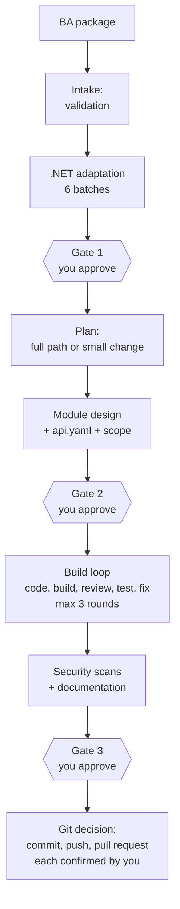

# .NET agents: architecture, flow and usage

This guide explains how the `dotnet-agents` plugin is built, how a run flows from a BA package to a pull request,
and how to use it on a new (greenfield) or an existing (brownfield) .NET codebase. For installation, see
[setup-github-copilot.md](setup-github-copilot.md).

---

## 1. The big picture

```mermaid
flowchart LR
    Dev([Developer]) -- chat --> Orch[dotnet-orchestrator]
    Dev -- "agents CLI: approve, decide, answer, rerun, rollback" --> Engine
    Orch -- "MCP tools" --> Engine[(Pipeline engine<br/>agents-engine)]
    Orch -- delegates --> Spec[Specialist agents]
    Spec -- "reports, builds, tests" --> Engine
    Hooks[Hooks] -. "check every tool call" .-> Orch
    Hooks -. .-> Spec
    Engine --> Store[(".agents/ in the project<br/>state, audit, checkpoints")]
    Engine --> WT["Run worktree<br/>(isolated Git worktree)"]
    Spec -- "edit code" --> WT
```

| Part | What it is | What it does |
|---|---|---|
| **Orchestrator** | The agent you talk to | Follows the engine's next step, delegates to specialists, explains results, prepares decisions. Never approves and never edits code |
| **Specialists** | Eight agents | Each does one kind of work in a fresh context: adaptation, design, code, review, tests, fixes, security, documentation |
| **Pipeline engine** | An MCP server (C#) inside the plugin | Owns the order of work, the gates, the limits and the checks. It validates every report and runs builds, tests and scanners. It keeps the state and the audit log |
| **Hooks** | Rules on the AI tool's events | Deny out-of-scope writes, secret access, unsafe Git commands and agent approvals; pause a run on outages |
| **Developer CLI** | The `agents` command | Your channel. Only you approve gates, decide, answer, re-run, roll back and confirm Git actions |
| **Run worktree** | A Git worktree next to your project | All changes happen there, never in your working copy, until you commit |

**Main principle:** the AI does the work, deterministic code checks it, and you decide.

---

## 2. The agents

| Agent | When it works | Output |
|---|---|---|
| `dotnet-orchestrator` | Always: the one you talk to | Status, decisions to make, gate packages, the Git proposal |
| `dotnet-adapter` | Adaptation, in six checked batches | The .NET view of the requirements: architecture, solution structure, data model, API, standards, dependencies, security, testing strategy, technology options |
| `dotnet-designer` | Design | Module design (new module), change design (existing code) or design note (small change), with `api.yaml` and the scope |
| `dotnet-coder` | Build loop, round 1 | Code inside the approved scope |
| `dotnet-reviewer` | Build loop | Findings with evidence |
| `dotnet-tester` | Build loop | A test for every acceptance criterion |
| `dotnet-fixer` | Build loop, rounds 2 and 3 | Fixes for the failures of the last round only |
| `dotnet-security` | Security and documentation | Interprets the secret, dependency, licence and analyzer scans |
| `dotnet-docs` | Security and documentation | XML documentation of public APIs, module README, change notes |

---

## 3. The flow of a run



| Stage | What happens | What you do |
|---|---|---|
| **Intake** | The engine validates the BA package: missing values, contradictions, injection, secrets. A BA team's folder of documents is imported and accepted first | Fix the package at its source if it is refused. For a folder: `agents ba import <folder>`, then `agents ba accept <IMP-nnnn>` |
| **Adaptation** | The adapter maps the requirements to .NET. Open points become questions or decisions | Answer and decide with the commands shown |
| **Gate 1** | The adapted design is put to you. For an imported package also one card per BA file with every line the BA marked [Assumed], the contradictions with both tables' rows and the stories open questions block | Confirm each [Assumed] line (or a whole card at once with the confirm-all command it shows) and each contradiction, or send it to the BA (`agents decide`); open questions are fixed in the BA documents, then `agents ba import`, `agents ba accept`, `agents rerun`. Then `agents approve <run> gate-1` or `agents reject … --comment "…"` |
| **Plan** | The engine decides between the full path and the small-change path | Nothing |
| **Design** | The module design, its API contract and the exact files it may change (scope) | Review |
| **Gate 2** | Design and scope are frozen after your approval | `agents approve <run> gate-2` |
| **Build loop** | Round 1: coder, reviewer, tester. Rounds 2 and 3: fixer (and review again when needed). Builds and tests run in a sandbox. After 3 failed rounds the run stops and you decide | Watch `agents status`; decide when asked |
| **Security and docs** | Scanners on the final code; documentation | Decide on open critical or high findings (fix, accept, defer) |
| **Gate 3** | The verification summary: build, analyzers, tests, review, acceptance criteria, fake-fix guard, scope, compatibility, design conformance (with requirements verified), security, docs. For an imported package, each functional requirement of the RTM: verified only when all its stories are | `agents approve <run> gate-3` |
| **Git** | A commit proposal (branch, message). Push and pull request follow | Say yes, then confirm each Git call in the AI tool |

### What keeps it safe

- **Checks, not promises.** A specialist's "done" counts only when the engine accepts its report. Tests that are
  deleted, skipped or weakened are caught (fake-fix guard).
- **Scope.** Every task may write only its approved paths. Engine files and secrets are never writable.
- **Limits.** At most 3 build-loop rounds; a time budget per run (`budget.max_minutes`). At 90% you are asked;
  at 100% the run pauses.
- **Traceability.** Each requirement is linked to its design, code and tests. Gate 3 shows requirements as verified
  only when their tests passed and their code is linked.
- **Interruptions.** If the AI service fails, the run pauses (it never fails), and the interrupted task restarts from
  its start. Checkpoints allow `agents rollback` before any commit.
- **Changes to requirements.** When the BA package changes, the run becomes Out of date. `check_staleness` shows
  exactly what changed, and `agents rerun` re-runs only the affected steps.

---

## 4. Greenfield: a new module

Use this for a new service or module with no existing code to protect.

1. **Prepare.** Create the repository with one commit, add `ba.json`, then run `agents init`.
2. **Start.** Tell the orchestrator: *"Start a run for the Orders module with ba.json, greenfield."*
3. **Adaptation.** Answer the questions it lists. Technology choices come as decision cards with 2 or 3 approved
   options and a recommendation; record yours with `agents decide <run> <decision> <option>`.
4. **Gate 1.** Read the adapted design summary, then `agents approve <run> gate-1`.
5. **Design.** The designer writes `design/<Module>/design.md`, `api.yaml` and `scope.json` in the run worktree.
6. **Gate 2.** Check the API and the scope, then `agents approve <run> gate-2`.
7. **Build loop.** Say *"continue"* as the orchestrator asks. Each round ends with builds and tests in the sandbox.
8. **Gate 3.** Read the verification summary; every check must pass. Then `agents approve <run> gate-3`.
9. **Git.** Answer the commit proposal. The engine commits to `agents/<run>-<module>`, then pushes and opens the pull
   request, each after your confirmation. Never to `main`.

---

## 5. Brownfield: changing an existing codebase

Use this when the module lives in an existing solution. The differences protect what is already there.

| Brownfield step | What it adds |
|---|---|
| **Baseline scan at start** | Before any change the engine builds and tests the current code and records a code profile. Errors, test failures and findings that already exist are marked *pre-existing* and are not the run's fault |
| **Extra adaptation batch** | Repository analysis, .NET project detection and brownfield mapping of the existing code |
| **Change design** | The designer writes a change design against the existing code instead of a new module design |
| **Strict scope** | Only the files the change design names may change. Anything else is refused, or put to you as a scope decision (widen to exactly those files, or revert) |
| **Compatibility check** | Public API changes are compared with the approved level (for example additive only) |
| **Pre-existing findings** | They block only when the change touches them |

Steps:

1. Open the existing repository (clean working copy, current commit), add `ba.json`, run `agents init`.
2. Tell the orchestrator: *"Start a run for the Billing module with ba.json, brownfield."* The baseline scan can take a
   few minutes on a large solution.
3. Continue as in the greenfield steps; at Gate 2, check the scope carefully. It is the list of files the run may
   touch.

### Small changes

For a small change to existing code (no API contract, no new entity or package, nothing security-sensitive, few
files), the engine offers the **small-change path**: a short design note instead of a full design. Every gate and
every check still runs. Only the engine decides that a change is small.

---

## 6. During a run

| Situation | What to do |
|---|---|
| You want to stop for the day | Ask the orchestrator to pause (it records a handoff). Tomorrow say *"continue"*: it resumes from the engine's record |
| The AI service fails | Nothing: the run pauses itself. Resume with `agents resume <run>` when it is back |
| The BA package changed | The orchestrator explains what changed; run `agents rerun <run>` |
| You want to undo the run's work | `agents rollback <run>` (before any Git commit; after it, use Git) |
| You want to edit the code yourself | After the third failed round, choose to step in. Edit the run's worktree, then `agents resume <run>` (the engine builds and tests your change) |
| The run's time budget is nearly used | Raise `budget.max_minutes` in `.agents/config.json` if you want to continue |
| You want to cancel | `agents cancel <run>` (you get a summary) |

---

## 7. Command cheat sheet

| Command | Use |
|---|---|
| `agents status [<run>]` | What waits for you |
| `agents approve <run> gate-1\|gate-2\|gate-3` | Approve a gate |
| `agents reject <run> <gate> --comment "…"` | Send the work back with what must change |
| `agents decide <run> <decision> <option>` | Record a decision |
| `agents answer <run> <question> "…"` | Answer a question |
| `agents pause <run>` / `agents resume <run>` | Pause and resume |
| `agents rerun <run>` | Re-run after the BA package changed |
| `agents ba import <folder>` / `agents ba accept <IMP-nnnn>` | Import a BA team's documents, then accept the import as the package |
| `agents rollback <run> [--to <checkpoint>]` | Roll back to a rollback point |
| `agents cancel <run>` | Cancel |
| `agents lesson list\|approve\|reject` | Lessons from finished runs |
| `agents metrics` | How your runs measure against the team's targets |
| `agents init` / `agents verify` | Prepare a project / check the installed plugin |

---

## 8. Good to know

- **Where things are.** Run state, reports, evidence and checkpoints are in `.agents/` of your project (git-ignored).
  The run's code is in the worktree folder next to your project (`../<project>-worktrees/<run>`).
- **One run at a time per module.** The orchestrator tells you when a module is busy.
- **Data.** Never put secrets, credentials or customer data in BA packages or chat; the engine refuses them.
- **Questions.** Ask the orchestrator *"where are we?"* at any time: it answers from the engine's records without
  starting any work.
